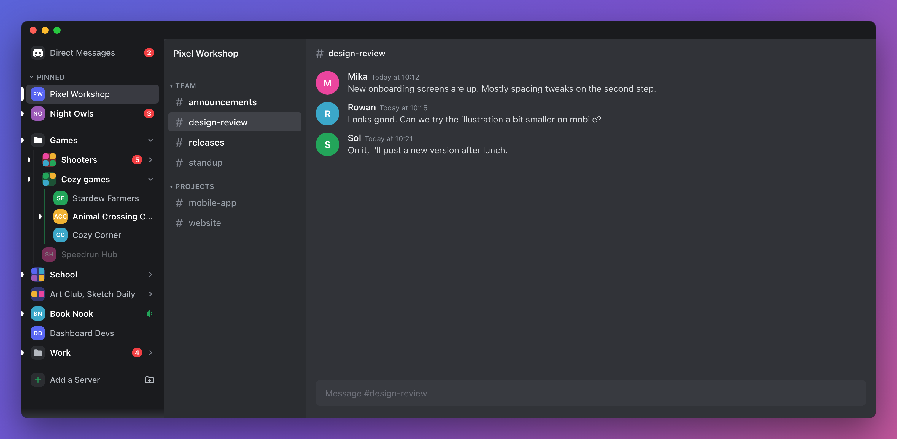
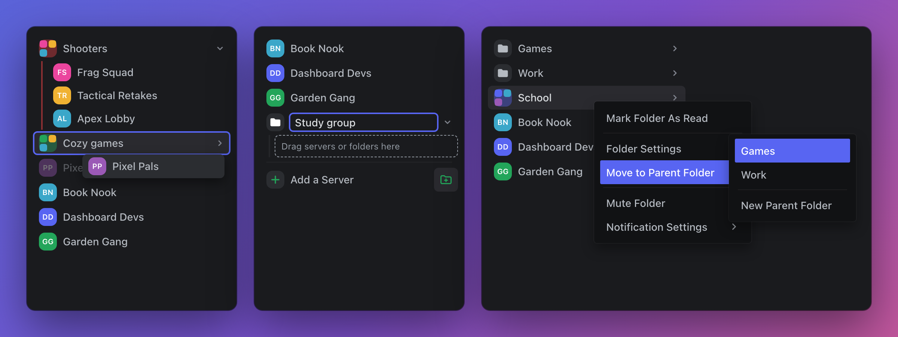

# ChungusServers

A wider server list for Discord. Folders show their names instead of a bubble of tiny icons, and you can drag servers and folders into whatever order you like. Drag the edge to make the list wider or narrower.

## Features

- **Named folders**: folders show their names. Click one to open it.
- **Pinned servers**: right-click a server and choose **Pin Server**, or drag it to the top.
- **Drag to reorder**: drag servers and folders anywhere. The order syncs to your Discord account.
- **Unreads at a glance**: unread servers are bright, mentions show a red count, and muted servers are dimmed.
- **Resizable**: drag the right edge. Double-click it to reset the width.
- **Icon mode**: drag the edge all the way in, or press Command-Shift-B (Ctrl-Shift-B on Windows), to get Discord's icon bar back.
- **Works with ChungusTabs**: Command-click (Ctrl-click on Windows) a server to open it in a new tab, or drag it onto the bookmark row.

## Folders

- **Drag into folders**: drop a server on a folder to put it inside, or on another server to make a new folder.
- **New folder button**: click the folder button next to **Add a Server** and type a name.
- **Folders in folders**: drop a folder on another folder to group them in a parent folder, or right-click and choose **Move to Parent Folder**.

## Good to know

- Pins and parent folders are only on this computer. Discord can't sync them.
- Parent folders go one level deep.
- To undo your changes, use **Restore original server order** in the plugin's settings.

## Install

1. [Download ChungusServers.plugin.js](https://raw.githubusercontent.com/echo4eva/discord-plugins/master/Plugins/ChungusServers/ChungusServers.plugin.js).
2. Put it in BetterDiscord's `plugins` folder and turn it on in BetterDiscord's Plugins settings.

## Develop

Edit [`src/ChungusServers/index.jsx`](../../src/ChungusServers/index.jsx), then run `npm run build:servers` from the repository root.
