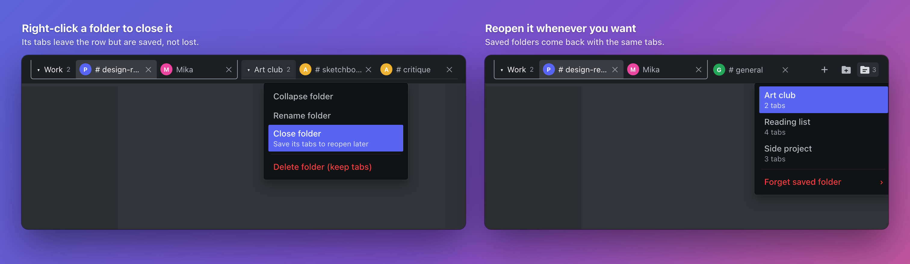

# ChungusTabs

Browser-style tabs for Discord. Group tabs into folders, close a folder to save it for later, and drag tabs and bookmarks wherever you want. Each tab remembers where you were scrolled, and on macOS the tab bar sits neatly beside the window buttons.

## Features

- **Tabs**: open channels, threads, and DMs in tabs. Right-click a tab for more options, or middle-click to close it.
- **Folders**: group tabs with the folder button, or drag a tab onto a folder. Click a folder to collapse it.
- **Save folders for later**: right-click a folder and choose **Close folder**. Reopen it from the saved-folders button with all its tabs.
- **Drag to reorder**: drag tabs, folders, and bookmarks. A blue line shows where they'll land.
- **Bookmarks**: keep favorite channels in a row under your tabs, and group them into folders.
- **Scroll memory**: each tab remembers where you were in the channel list, the chat, and the member list.
- **Copy link**: right-click a tab to copy its Discord link.

## Shortcuts

| | Windows | macOS |
| --- | --- | --- |
| Open a channel, thread, DM, server, or bookmark in a new tab | Ctrl-click | Command-click |
| New tab | Ctrl-T | Command-T |
| Close the current tab | Ctrl-W | Command-W |
| Previous / next tab | Ctrl-Page Up / Page Down | Ctrl-Page Up / Page Down |
| Jump to tab 1 to 9 | Ctrl-1 to 9 | Command-1 to 9 |

You can change every shortcut, or turn it off, in the plugin's settings.

## Install

1. [Download ChungusTabs.plugin.js](https://raw.githubusercontent.com/echo4eva/discord-plugins/master/Plugins/ChungusTabs/ChungusTabs.plugin.js).
2. Put it in BetterDiscord's `plugins` folder and turn it on in BetterDiscord's Plugins settings.
3. ChungusTabs runs alongside the original ChannelTabs, but the two both draw a tab bar, so turn the original off. If you used this plugin as **ChannelTabsMac** or **ChannelTabs**, turn that one off and delete its file.

This is a fork of the original [ChannelTabs](https://github.com/samfundev/BetterDiscordStuff/tree/master/Plugins/ChannelTabs) by l0c4lh057 and CarJem Generations, previously called ChannelTabsMac and then ChannelTabs. It keeps its own settings, so tabs from the original ChannelTabs aren't copied over. Tabs saved under ChannelTabsMac carry over.

## Develop

Edit [`src/ChungusTabs/index.jsx`](../../src/ChungusTabs/index.jsx), then run `npm run build:tabs` from the repository root.
