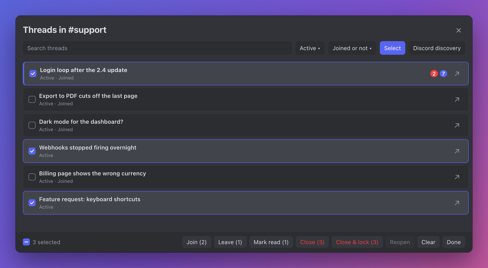

# ThreadNavigator

A better way to browse threads. Click the Threads button to see every thread in the channel, then search, filter and open one on the side while the list stays put. Select several threads to join, leave or close them all at once.

ThreadNavigator turns Discord's **Threads** button in a text channel into a browser in the middle of the window. It replaces the channel's chat area while open. Clicking a thread opens its chat in Discord's right-side thread panel, so the browser stays visible while you move between threads. Click **×** or the Threads button again to return to the channel chat.

The middle browser stays open when you switch ChannelTabsMac tabs or move to another text channel, and updates to that channel's threads. Switching away from a supported channel hides it temporarily; it reappears when you return to a text channel. Close it with **×** or the Threads button when you want the normal chat view again.

The browser is open per tab and channel: it appears only in the tab and channel where you opened it. Other tabs, including a new tab opened on one of this channel's threads, and other channels show their normal chat, and returning to that tab and channel brings it back. This per-tab behavior needs ChannelTabsMac; without it the browser is open per channel. The browser scrolls within the middle pane using Discord's scrollbar colors and stretches each thread row across the available width. It has search, filters for active, loaded archived, and all loaded threads, and a filter for threads you have or have not joined. Threads sort with mentions first, then threads with unread messages, then the rest, newest activity first within each group. Read threads work like a stack: the thread you read last sits on top of the read group and sinks as you read or update other threads, and a new message brings it back up as unread. The read order is remembered until Discord restarts. Each thread shows a red badge with its mention count and a blue badge with its unread message count, matching the ChannelTabsMac badges. It also marks joined and locked threads and highlights the thread currently open on the right. The arrow beside a thread, or Command-click on its name, opens a [ChannelTabsMac](../ChannelTabsMac/README.md) tab when that plugin is enabled. Right-click a thread row for the same menu you get on that thread in the channel list, including any items ChannelTabsMac adds (such as opening it in a new tab). If Discord's menu can't be loaded, a smaller menu offers Open thread, Open in new tab, Copy link and Copy thread ID. **Discord discovery** inside the browser opens Discord's original thread discovery view.

## Bulk actions

Click **Select** in the browser, or Shift-click any thread, to turn on selection mode. Click threads or their checkboxes to select them; Shift-click selects a range. Command-A, or the checkbox in the bottom bar, selects every thread the current search and filters show. Escape or **Done** leaves selection mode.

The bottom bar lists what you can do with the selection: **Join**, **Leave**, **Mark read**, **Close**, **Close & lock**, and **Reopen**. Each button counts only the selected threads it applies to, so a mixed selection never sends useless requests. For example, Join skips threads you already joined, and Close skips archived ones. Closing and locking require Discord's Manage Threads permission; thread creators can close and reopen their own unlocked threads. Close and Close & lock ask for confirmation first.

Requests go one at a time with a short pause to stay within Discord's rate limits; **Stop** cancels the rest. A toast reports how many succeeded and why any failed. The **Joined / Not joined** filter pairs well with this: filter to Joined, select all, then Leave.

## Install

1. [Download ThreadNavigator.plugin.js](https://raw.githubusercontent.com/echo4eva/discord-plugins/master/Plugins/ThreadNavigator/ThreadNavigator.plugin.js).
2. Put it in BetterDiscord's `plugins` folder and enable **ThreadNavigator** in BetterDiscord's Plugins settings.
3. Optionally install and enable [ChannelTabsMac](../ChannelTabsMac/README.md) for new-tab actions.

Discord only provides the plugin with threads already loaded in the client. The archived filter does not fetch the channel's complete archive; use **Discord discovery** for older threads. This plugin targets Discord's current desktop layout and may need updates if Discord changes it. It is a community fork, not a BetterDiscord store listing.

## Develop

Edit [`src/ThreadNavigator/index.jsx`](../../src/ThreadNavigator/index.jsx), then run `npm ci` and `npm run build:threads` from the repository root. Commit the source and built plugin together. The built plugin appears in this folder; the build does not install it in BetterDiscord.

The plugin uses BetterDiscord's Webpack store access to read channels, threads, membership, permissions, and unread state. Bulk join, leave, close, and reopen go through Discord's own request client to the public thread endpoints; Mark read dispatches Discord's bulk-acknowledge action. It adds the browser beside Discord's native right-side thread panel and removes its controls when disabled. The repository's [MIT license](../../LICENSE) applies.
