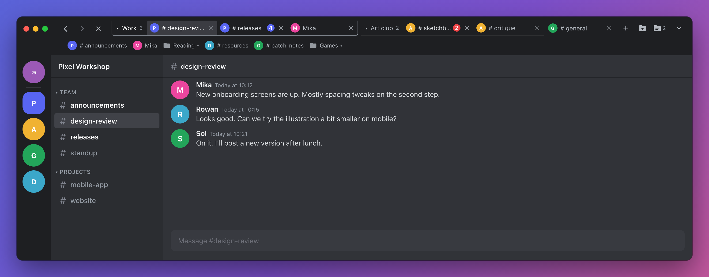
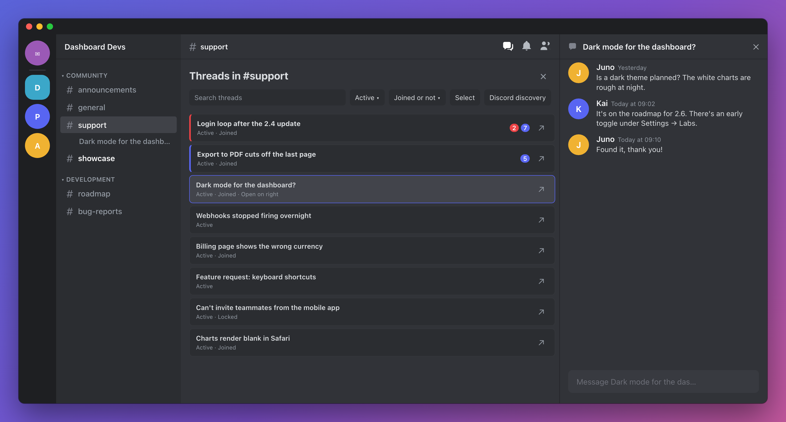
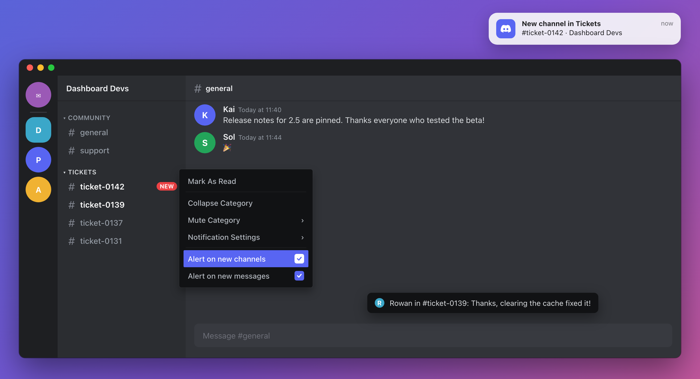

# discord-plugins

BetterDiscord plugins by echo4eva.

## [ChannelTabsMac](Plugins/ChannelTabsMac/README.md)

Browser-style tabs for Discord. Group tabs into folders, close a folder to save it for later, and drag tabs and bookmarks wherever you want. Each tab remembers where you were scrolled, and on macOS the tab bar sits neatly beside the window buttons.

## [ThreadNavigator](Plugins/ThreadNavigator/README.md)

A better way to browse threads. Click the Threads button to see every thread in the channel, then search, filter and open one on the side while the list stays put. Select several threads to join, leave or close them all at once.

## [CategoryAlerts](Plugins/CategoryAlerts/README.md)

Get notified when something happens in a category you care about. Right-click a category to get alerts for new channels, new messages, or both. Each kind of alert has its own sound.

## Credits

ChannelTabsMac is built on [ChannelTabs](https://github.com/samfundev/BetterDiscordStuff/tree/master/Plugins/ChannelTabs) by l0c4lh057 and CarJem Generations, maintained by samfundev and contributors in [samfundev/BetterDiscordStuff](https://github.com/samfundev/BetterDiscordStuff). This repository started from that one and keeps its git history and build tooling. ThreadNavigator and CategoryAlerts are original to this repository.

Everything here is under the [MIT license](LICENSE), which keeps the original ChannelTabs copyright notice.

## Problems

If you have a problem with something, please [open an issue about it](https://github.com/echo4eva/discord-plugins/issues/new/choose).

## Building

Edit the files in `src`, then run `npm ci` and one of these from the repository root to build into `Plugins`:

- `npm run build:mac` for ChannelTabsMac
- `npm run build:threads` for ThreadNavigator
- `npm run build:alerts` for CategoryAlerts
- `npm run build` for all of them

Don't edit the files in `Plugins` directly. Each plugin's changelog is generated from commit messages that start with `added:`, `fixed:`, `improved:`, or `progress:`.

The README images are mockups with sample data, built from the plugins' own styles in [`docs/mockups`](docs/mockups). After changing one, run `docs/mockups/render.sh` (it uses Google Chrome) to regenerate the PNGs in `docs/images`.
